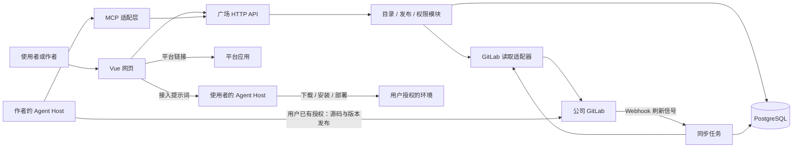
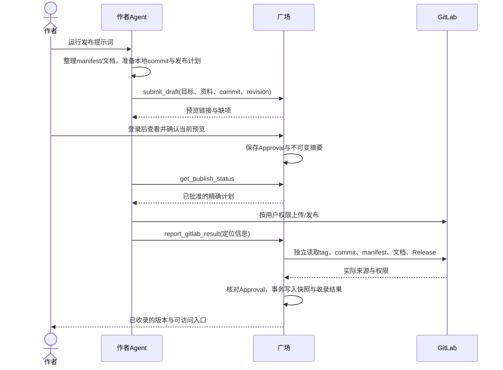

# AI应用广场架构设计

状态：0.1 评审草案 · 2026-10-10 · [设计任务 #5](https://github.com/Dylan5237/ai-app-plaza/issues/5)

需求依据：[需求草稿 aa30a5b](https://github.com/Dylan5237/ai-app-plaza/blob/aa30a5b8aa61dd58599b993958fe51799eb4c0ce/docs/product/requirements.md)。需求和本方案均未冻结；下文的“采用”表示推荐方案，不代表环境已经接通或实现已经完成。

## 1. 总体建议

采用 **Vue 网页 + 一个模块化后端 + PostgreSQL + GitLab 适配器**。MCP 是同一后端面向 Agent 的接入方式。首期不引入微服务、独立搜索集群、向量数据库或在服务端运行 Agent 的能力。

核心分工：GitLab 保存入驻应用源码、资料和版本；广场维护可查询的资料副本、发布预览与收录状态；作者 Agent 在作者环境中写 GitLab；使用者 Agent 在用户环境中安装或部署。广场必须从 GitLab 核验结果，不能仅凭 Agent 自报收录成功。

推荐先确定五项选择：

| 选择 | 推荐方案 | 原因 / 尚需确认 |
| --- | --- | --- |
| 资料载体 | `ai-app.json` 描述机器可读信息，README / 使用文档承载说明 | 避免依赖自由文本标题和段落解析；文件均由作者 Agent 生成，不增加手填表单 |
| 版本依据 | GitLab tag + 精确 commit SHA；Release 展示版本说明与产物 | 保证预览、收录和接入指向同一份资料；目标 GitLab 能力需实测 |
| 用户和权限 | 优先 GitLab OAuth 登录；目录可见性不扩大仓库权限 | 先复用已有身份；公司 SSO / OAuth 配置和具体读取 scopes 待验证 |
| 发布执行 | 作者 Agent 执行 GitLab 操作；广场核验与登记 | 广场不保管作者的 Git 写入凭据，也不变成部署平台 |
| 检索 | 结构化过滤 + 名称/标签/能力文本关键词检索 | 先建立可测基线；语义召回按中文任务样本评估后决定，不因输入自然语言就承诺已理解 |

## 2. 现状与设计起点

当前仓库是 Vue 3 / Element Plus 承载的静态原型，页面主体位于生成的 `portal.html`；数据来自本地 JSON，脚本将其合成为 17 项 Mock。尚无认证、数据库、真实搜索服务、GitLab 同步和外部 Agent 草稿回传。

本方案复用已确认交互与 Vue 技术基础。正式实现逐步把页面数据和状态迁到后端接口，不将 iframe、Mock 数据格式或 Python 合成脚本规定为生产架构。入驻应用的业务资料来自 GitLab，与广场自身代码使用 GitHub `origin` 管理是两件事。

## 3. 组件与边界

| 模块 | 负责 | 不承担 |
| --- | --- | --- |
| 网页 | 能力发现、标签、收藏、详情、只读预览、确认与结果 | 持有 GitLab 写入凭据；根据动画判断发布成功 |
| 目录服务 | 应用、固定版本快照、标签、权限过滤与检索 | 执行仓库代码；把目录副本当源码权威 |
| 发布服务 | 草稿、预览摘要、作者确认、阶段记账、幂等与核验 | 替用户直接 push、合并 MR 或安装应用 |
| MCP 适配层 | 对 Agent 提供草稿提交、结果查询、接入资料等工具 | 独立保存另一套发布状态；充当 Agent 运行环境 |
| GitLab 适配器 | 读取项目、权限、文件、tag、Release 与产物元信息 | 透传任意 URL 和凭据；扩大当前用户权限 |
| 同步任务 | 消费刷新事件、重试、周期对账、重建目录投影 | 将 webhook 内容或 Agent 报告直接升级为最终事实 |

部署单元建议为一个 Node.js / TypeScript 后端代码库、API 与 worker 两个启动入口、一个 PostgreSQL 实例。API 和 worker 可在同一主机运行；通过数据库任务表协调，不先引入 Redis / 消息集群。框架、数据库版本与并发配置在公司运行环境验证后固定，前端沿用 Vue 3 / Element Plus。

## 4. 事实来源与数据模型

### 4.1 谁保存什么

| 事实 | 权威来源 | 广场保存的内容 |
| --- | --- | --- |
| 项目身份、仓库访问权限 | GitLab 实例和项目 | 项目 ID、显示路径、权限核验记录；路径变更不改变身份 |
| 名称、能力、标签、说明及入口 | 固定 commit 上的 manifest 与引用文档 | 可重建的版本快照、来源路径与内容摘要 |
| tag / Release / commit | GitLab | 不可变版本绑定与读回证据；不将 tag 名单独当不可变身份 |
| 草稿、作者确认、发布进度 | 广场 | revision、批准摘要、操作记录、错误与审计 |
| 收藏 | 广场 | 用户与稳定应用标识的关联；是否首期开放仍按需求评审 |
| 实际安装和业务执行 | 用户 Agent / 目标平台 | 首期不推断、不收集为发布成功标志 |

### 4.2 最小实体

| 实体 | 关键字段 / 约束 |
| --- | --- |
| `GitLabInstance / UserConnection` | 管理员登记 instanceId 与规范化地址；每用户连接绑定 principalId、GitLab userId、scopes、凭据引用和授权状态，凭据加密隔离保存 |
| `Application` | appId、instanceId、projectId、appKey、manifestPath、activeVersionId；唯一 `(instanceId, projectId, appKey)` |
| `ApplicationVersion` | versionId、tag、commitSha、manifestDigest、文档摘要、Release 元信息、批准记录；快照不可覆盖 |
| `PublishDraft` | draftId、ownerUserId、目标项目、revision、manifest/文档草稿、计划 ref 与 commit、内容摘要；不存 Git 写入 token |
| `Approval` | draftId、revision、approvalDigest、确认用户、时间、过期/撤销状态 |
| `PublishOperation` | operationId、批准摘要、各阶段 observedState、evidence、lastError；保存 branch/MR IID/tag/commit/Release 定位，同一批准重复执行返回原操作 |
| `SyncJob / EventInbox` | instance/project/ref、事件去重键、尝试次数、下次执行时间；事件先落库再处理 |
| `Favorite / AuditEvent` | 用户与应用关联；敏感操作操作者、对象、结果与时间，不记录明文 token |

`ApplicationVersion` 的幂等键为 `(appId, tag, commitSha, manifestDigest)`；同一 `appId + tag` 已收录后指向另一个 commit，应标记来源漂移并要求新版本，不静默覆盖。名称和路径均可变化，不能作为 appId。

### 4.3 版本、日期与默认版本

- 推荐卡片“创建时间”表示 GitLab 项目创建时间；“更新时间”表示当前已收录版本的发布时间。详情明确标注含义，另显示广场收录/同步时间，避免把后台刷新时间冒充作者更新。
- 版本显示取批准的 tag，Release 存在时补充其说明；缺少有效发布时间时显示未提供，不伪造时间。Release 发布时间可能被修改，因此读回并记录，不能把该时间当安全校验依据。
- 推荐首期要求正式收录具有 tag 与 Release，文档和入口必须与 tag 解析出的 commit 一致。预览可先于远端写入；旧项目无版本时由作者 Agent 生成发布提案，不要求手填。
- `activeVersionId` 由作者确认的收录操作更新；后台不得简单选择字典序最大 tag 或最近分支提交。并发发布采用应用修订号比较：较旧操作可以保存其快照，但不能覆盖较新的 activeVersion。
- 用户可能同时维护多种入口：manifest 使用 `entries[]`，每个入口只分 `web`、`agent` 两类，指定主入口。形态不成为目录分类或表结构分支。

版本、日期含义和首期要求 Release 是对需求 Q3 的建议，需要评审确认。

## 5. 仓库资料契约

推荐使用 `ai-app.json`，而非从任意 README 文案中猜测字段。AI 为仓库补齐 manifest 和文档，再交作者预览。没有 manifest 的已有项目，由其 Agent 首次登记时生成；不让广场后台用模型编造缺失入口。

manifest 只包含应用业务资料，不重复填写项目 ID、版本号、创建/更新时间或收录状态。上述信息分别来自 GitLab 和广场记录。字段格式、样例与约束见[资料契约草案](data-contract.md)。

默认路径是仓库根的 `ai-app.json`；一库多应用可使用 `.ai-apps/<appKey>/ai-app.json`，每个应用显式绑定 manifestPath，不递归扫描整库猜测应用。相对文档路径始终以仓库根为基准。

同一 commit 中：manifest 是结构化字段来源，README / usage 文档是详细说明来源。显式重复字段冲突时确定性校验提示作者修订；自然语言含义的一致性由作者 Agent 检查、作者预览确认，不能承诺后台识别所有语义冲突。JSON 解析与字段校验确定性执行；文档按不可信 Markdown 渲染，不执行 HTML、脚本或“接入指令”。

对 Skill，保留其原有 `SKILL.md` 和目录结构；广场 manifest 仅引用接入说明，不替换 Skill 格式。[Agent Skills 规范](https://agentskills.io/specification)定义技能文件格式，而非所有 Host 通用的安装命令；不能承诺一条跨宿主安装协议已经存在。

## 6. 身份、权限与接入通道

### 6.1 用户权限

推荐浏览器采用 GitLab OAuth 登录，用户身份为 `(instanceId, GitLab userId)`；GitLab OAuth scopes 与用户原有项目权限共同限制读取。`read_api`、Repository Files API 等所需 scope 组合必须对公司版本实际验证，不能把文档中 PAT 权限列表直接当成 OAuth 端点实测结果。[GitLab OAuth](https://docs.gitlab.com/integration/oauth_provider/)、[文件 API](https://docs.gitlab.com/api/repository_files/)

广场为该身份映射唯一 `principalId`。网页会话与 MCP token 都绑定这个主体；首期草稿提交者、所有者、网页确认者必须相同，不支持代理他人批准。用户级 GitLab 只读授权连接也绑定此主体；注册实例不等于拥有实例内所有用户的授权。MCP 登录与网页登录应回到同一身份流程，不能用可伪造的 username 参数关联账号。

建议浏览权限同时满足“广场登录用户属于允许组织”和“该用户可读该 GitLab 项目及应用资料”。发布确认建议仅允许经 GitLab 核验的项目维护者，首期可用 Maintainer 及以上作为默认提案，最终由 Q1 确认。

服务端目录投影可能包含私有资料，必须在返回列表、标签统计、搜索建议、详情、文档、接入提示词及 MCP 资源前校验当前用户权限。首期每个请求实时获取该用户可访问的候选项目，先过滤再排序/分页/计数；详情再次校验目标项目。读取失败时不使用共享高权限账号兜底。后续如增加 ACL 缓存，须先定义撤权时效并验证，不能只靠前端隐藏。

后台读取可使用发布者授权的只读连接；授权到期、撤销或用户离职时任务显示待重新授权。OAuth 的读取 scope 可能覆盖该用户可访问的多个项目，并非单项目授权；适配器仅处理已明确绑定的实例/项目，不因 token 能读就自动收录。后台项目级凭据可作为后续替代方案单独评估。若后续采用服务账号建共享索引，它的读取范围不能变成使用者可见范围。凭据加密保存、日志脱敏，源库权限变化时重新校验；GitLab 不可达时不向无法完成鉴权的用户返回私有缓存。

### 6.2 Agent 接入广场

发布提示词只包含广场地址、公开的接入说明、资料契约版本和操作目标，不包含 token 或可绕过认证的预览链接。Agent 使用已经接入的广场 MCP；首次接入依据 Host 支持能力完成登录授权，之后提交草稿并取得普通预览链接。链接本身不是凭据，浏览器仍检查登录身份及草稿归属。

建议首期以支持远程 MCP 的目标 Host 验证 Streamable HTTP 路径；不假设所有 Harness 支持同一传输、OAuth 或确认 UI。MCP 的 access token 应面向广场资源，不得把收到的 token 直接透传给 GitLab；GitLab 的读写凭据分别通过对应授权渠道获得。[MCP 授权规范](https://modelcontextprotocol.io/specification/2026-07-28/basic/authorization)

MCP 仅是 HTTP 服务的适配层，同一授权逻辑、同一状态与幂等键。没有可靠 MCP 支持的 Host 先按“暂不支持该自动接入路径”反馈；是否提供官方 CLI 适配器是后续选择，不引导用户把 token 粘进提示词作为替代。

建议的最小 MCP 工具：

| 工具 | 作用 | 约束 |
| --- | --- | --- |
| `get_publish_contract` | 取得规范、示例与预检要求 | 不泄露其他用户项目 |
| `submit_draft` | 创建/更新草稿，返回 draftId、revision、previewUrl | 认证主体决定归属；并发更新检查 revision；旧确认失效 |
| `get_publish_status` | 查询确认和阶段结果 | 只读；长期操作通过查询恢复，不依赖 Host Tasks 扩展 |
| `report_gitlab_result` | 提供项目、tag、commit 等定位信息，触发读回 | 仅作线索，不能将任意 phase 标成成功 |
| `retry_registration` | 对批准的同一版本重试核验/收录 | 先查已有证据，只补失败阶段 |
| `get_agent_instructions` | 返回应用固定版本的接入资料 | 与网页详情相同的 ACL 和版本来源 |

作者确认由登录网页的独立操作完成，MCP 不提供可让同一 Agent 自行批准的工具。允许用户在自己的 Agent 中拒绝或停止，网页确认也不替代 Host 对实际写入动作的授权。

## 7. 作者发布完整流程

### 7.1 主流程

1. Agent 在本地准备 manifest、使用说明及拟发布源码，生成本地 commit；提交草稿时携带已知 commit SHA、文件摘要、目标项目/ref、版本与拟上传文件摘要。准备本地 commit 不代表允许推送。
2. 广场校验结构和来源绑定，标注“待远端核验”；预览由提交的资料确定性生成。草稿属于认证主体，其他作者无法凭 draftId 查看或确认。
3. 作者在网页确认 `draftId + revision + approvalDigest`。摘要覆盖目标实例/项目、appKey、manifestPath、预期 commit、tag、manifest 与引用文档原始 UTF-8 字节摘要、Release 计划、产物 URL/校验值、当前应用修订号及公开范围快照。修改任何上述内容都使确认失效；确认过期或撤销后不得继续收录。
4. Agent 取得已批准计划，用用户授权的 GitLab 身份执行。广场确认不绕过项目保护分支：必须走 MR 时先创建 MR，状态显示“等待项目流程”。合并或 squash 使 commit 改变时，重新生成最终 commit 的草稿并确认后才可发版收录；此时复用已合并源码，不再为相同资料创建一次提交。这是常见 MR 流程可能需要二次确认的明确取舍，待产品评审。
5. Agent 报告定位信息；广场用独立读取权限核对批准的 tag 指向 commit、manifest 与文档摘要、Release、产物声明和当前作者发布权限。全部匹配才能收录。
6. 最终收录与撤销批准通过同一 Approval 行锁串行化；事务内检查未撤销、数据库时间未过期且 revision 匹配，转为 `consumed`，同时写入版本快照、目录字段和操作结果。事务失败则整体回滚。主版本切换另按应用修订号条件更新；较旧操作只登记版本时明确返回 `isActive=false` 和版本链接，不冒充当前默认版本，切换需要新的确认。远端核验记录保留观测时间；GitLab 与本地数据库没有跨系统事务，后续来源变化由对账发现并降级，接入始终使用固定 commit。

外部 Agent 拥有自己的 GitLab 凭据，广场不能在技术上阻止它绕过流程直接 push；本方案保证的是“未满足确认与核验的内容不进入广场”，并通过 GitLab 分支保护和 Host 授权控制真实仓库写入。Agent 应在写入前核对实际账号和计划身份；广场不把 Agent 自报、Git commit author 或 Release author 当作实际 push 操作者的可靠证明。首期核验的是批准者当前拥有发布权限、远端内容与批准摘要一致，不能声称已证明每次外部写入都由该账号执行。

### 7.2 新仓库、已有版本与后台更新

- 新仓库：Agent 先提交目标 namespace/path、可见范围和创建意图供作者确认；作者通过 Host 授权创建空项目。广场读回真实 projectId 与权限后，再生成可批准的正式发布预览，不能凭路径认领已有同名项目。建空仓本身作为单独执行结果展示。
- 已有应用：绑定 projectId/appKey，草稿基于已有 activeVersion 修订号；名称、标签或入口变化也走新资料版本，不另建一个同名应用。
- 已有 GitLab 版本：可以提交“登记现有版本”的草稿；广场先读回资料用于预览。确认后复用真实源码/版本证据，跳过实际上传与发版。
- 后台同步只自动修复已批准且固定到 commit 的投影、权限和同步状态。新 tag 或默认分支变化只产生“发现新版本，待作者确认”的候选，不自动提升为广场主版本。否则会绕过作者的预览确认。
- 如后续希望 GitLab CI 自动收录，必须另行约定可信审批来源与授权范围；首期不把任意 webhook 当作批准。

### 7.3 阶段与恢复

草稿先经过 `draft → preview_ready`；确认后生成 Approval，状态由 `approved` 转为 `consumed / expired / revoked` 之一。编辑未完成收录的已批准草稿，会通过同一批准锁撤销旧批准、产生新 revision 并回到待预览。`consumed` 表示批准已用于一次正式收录，之后不能靠撤销草稿撤回已收录版本，批准期限也不追溯影响已收录的快照；重新登记相同操作可直接查询或修复其既有结果。发布操作在批准后建立，记录三个独立阶段：

| 阶段 | 可确认成功的证据 | 未完成时 |
| --- | --- | --- |
| `source` | 目标项目可读，预期 commit 与文件可读 | 等待授权/MR/上传；Agent 报告只记 reported |
| `release` | 批准 tag、commit 与 Release 对应，产物声明一致 | 先查现状，再让 Agent 修复；不重复创建已存在版本 |
| `catalog` | 相同版本快照及其登记结果已事务提交 | 可独立重试，不回头要求重新上传源码 |

每阶段区分 `pending / reported / verified / failed / unknown`，总体结果只由已核验证据计算。另用 `waitingReason` 表达 `awaiting_mr / reapproval_required / authorization_required` 等等待原因；MR 合并只是 source 可核验的线索，不等于 Release 或收录完成。状态未知时先对账；失败记录错误类别与下一步，不自动把未知当失败再写一次。`install` 不在这三个阶段内，“已收录”绝不代表“已安装”。

广场幂等控制分三层：请求以 `actor + operation + idempotencyKey` 唯一；相同键不同请求摘要返回冲突；发布以批准摘要复用操作；快照按版本唯一键去重。重复确认、超时重发、同一 webhook 重投与 worker 重启都可恢复。这不等于 GitLab 外部写入天然幂等。

发布提示词要求 Agent 恢复前先读取已记录的 branch、MR IID、tag、commit 和 Release：同目标且内容相同则复用；不同内容则报冲突并停止，不 force、不覆盖 tag/Release；缺失才补做。MR 先按已记录 IID 定位，首次结果未知时按源/目标分支与操作标识对账，不能盲目新建；确需修改计划时回到预览。广场记录这些外部对象与读回结果，使换一个 Agent 继续时仍可找到同一操作。

产物核验在首期比较批准计划与 manifest 中的 URL/SHA-256，并核对 Release asset 链接对应的 URL。GitLab Release asset link 没有原生 SHA-256 字段，不能假设从 Release 直接取得可信包摘要。[Release API](https://docs.gitlab.com/api/releases/) 广场不据此宣称下载包字节已验证；实际包哈希由用户 Agent 下载后核对，详见[资料契约](data-contract.md)。

## 8. GitLab 同步与检索

Repository Files API 支持用 commit 作为 ref；需对原始字节做摘要时读取 raw endpoint，避免文本编码转换影响摘要。tag 先解析到固定 commit 再取资料，不从 `main` 或 `latest` 拼接接入提示词。[GitLab 文件 API](https://docs.gitlab.com/api/repository_files/)、[Tags API](https://docs.gitlab.com/api/tags/)

同步采用“显式发布核验 + Webhook 提醒 + 定时对账”。Webhook 验证配置的来源凭据后先落 EventInbox、快速应答，再异步读取 GitLab；不能假设不重复、不乱序或永不丢失。事件头和失败补发能力存在版本差异，去重键按已验证能力选用；低版本回退到项目/ref/事件类型与内容摘要，并以 API 对账兜底。[GitLab Webhooks](https://docs.gitlab.com/user/project/integrations/webhooks/)

删除、归档、撤权和 tag 漂移分别记录原因：撤权立即影响访问判断；无法读取时显示同步失败而非删除应用；确认删除或来源漂移后停止提供有效接入入口，保留有权限者可见的审计记录。既有收藏不绕过这些限制。

检索先做 ACL，再做标签交集、关键词和相关度排序；用户标签保留原文，同时生成去首尾空格、Unicode 规范化和大小写折叠的检索键。近义词只作查询建议，不擅自修改作者标签。建议多标签 AND 与需求查询取交集，作为 Q2 的待确认规则。

首期可用 PostgreSQL 文本字段、标签索引和必要的 `pg_trgm` 相似/子串索引；中文分词与相关度用真实任务样本测试，不能把 trigram 当语义理解。若不足，再评估受权限过滤约束的向量召回及公司批准的模型服务。[PostgreSQL pg_trgm](https://www.postgresql.org/docs/current/pgtrgm.html)

## 9. 使用者接入流程

平台入口只打开经登记的 HTTP(S) 应用地址；目标平台自行处理登录和权限。广场不给目标平台转发 GitLab access token，也不以打开成功推断业务可用。

Agent 入口生成接入提示词，绑定 appId、versionId、commit SHA、接入说明路径、兼容条件、产物摘要和验证方法。Agent 从授权渠道读取固定版本说明，确认 Host/OS、已有版本及权限，进行接入并报告结果。可复制提示词里没有凭据；复制成功只是交接成功。

Skill 采用其规范目录；MCP 应用按服务提供的配置与对应授权接入；本地工具由 Agent 取得固定版本安装包并核对摘要后部署。广场不执行这些步骤、不解析文档为服务端 shell。初次接入可能需要用户登录、批准配置或重载 Host，不能承诺所有环境无交互一次完成。

Release asset 可能是外部链接或重定向，不能把“GitLab Release 页面里的链接”直接认作可信本地包。首期广场只传递经允许的来源和校验信息，不代理下载任意 URL；私有包由用户 Agent 取得正确授权后读取。若将来增加下载代理，须单独限制目标地址/重定向并防止凭据跨主机发送。[Release assets](https://docs.gitlab.com/user/project/releases/release_fields/)、[Generic Packages](https://docs.gitlab.com/user/packages/generic_packages/)

## 10. 验证与实施切分建议

| 切分 | 产出 | 验证重点 |
| --- | --- | --- |
| 环境与契约验证 | 一个位于测试范围的 GitLab 项目、固定版本读取、登录授权、目标 Host 连通性证据 | 真实权限矩阵与撤权、manifest/文档摘要、tag漂移、MCP认证；不使用 Mock 代替 |
| 只读应用目录 | 正式数据驱动的发现/标签/详情/入口，目录投影 | 隐私过滤、日期版本含义、刷新失败、中文查询基线 |
| 作者发布闭环 | Agent 草稿回传、作者确认、外部写入结果核验、幂等收录 | 确认后改稿、并发提交、超时未知、收录独立重试、禁止自批准 |
| 运维与接入完善 | 对账、审计、备份恢复、Host兼容记录 | worker重启、事件遗漏、凭据过期、恢复后可查同一操作 |

以上是后续可冻结的切分提案，不是已启动的开发阶段。当前不固定吞吐或延迟数值：先确认项目量、并发人数、GitLab 限流与网络条件，再制定可验收目标。部署需 TLS、日志脱敏、数据库备份及恢复演练；大文件留在 GitLab/公司分发服务，不放广场数据库。

设计应能通过以下关键场景：

1. 用户 A 可读项目、B 不可读时，B 在搜索结果、标签数量、提示词和 MCP 响应中都得不到该项目的信息。
2. 作者批准后改 tag、commit、资料或产物地址，广场拒绝沿用旧批准。
3. Agent 自报“上传/发布完成”，GitLab 读回不匹配时不收录。
4. GitLab 完成、目录写入失败时，仅重试收录并复用同一应用版本。
5. 发布请求超时、进程重启或消息重复后，能够按同一 operationId 查询实际结果。
6. tag 被重写、来源权限撤销或后台发现新版本时，不静默切换到未经确认的新内容。
7. Skill、MCP、本地工具与平台均可用同一 manifest 骨架表达，列表无须增加形态分类。

## 11. 冻结前的确认项

| 待确认 | 当前建议 / 需要的证据 |
| --- | --- |
| GitLab 实例与组织权限 | 版本/套餐、OAuth可用性、用户读取和发布权限、项目创建与保护分支策略 |
| manifest 与版本口径 | JSON + README/usage；稳定appKey；tag/commit/Release；卡片日期含义 |
| 发布责任与作者确认 | Agent写入、广场读回；网页确认不可变摘要；新仓库和MR的二次确认 |
| Host兼容范围 | 选定首批真实Harness验证远程MCP与认证，不默认所有Host即插即用 |
| 同步与搜索目标 | 项目规模、允许同步延迟、中文查询样本、撤权时效、标签组合规则 |

技术依据于 2026-10-10 核对官方文档；公司 GitLab 版本、OAuth、Webhook、包权限和 Host 支持均未实测。官方能力存在不等于本环境已经具备。
